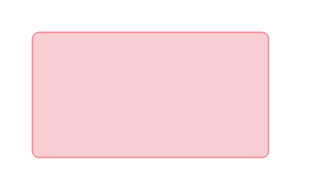

# Rounded Desktop & Explorer Selection

Mod Windhawk para seleção e hover translúcidos, com cantos arredondados,
no desktop e no Explorador de Arquivos. Versão experimental 0.3.2 para Windows 11 x64.



O seletor do desktop e da área de arquivos usa raio configurável, com padrão
de 8 DIP. Linhas de arquivos usam o mesmo estilo; cabeçalhos e botões de
visualização do canto inferior usam raio menor de 4 DIP. Cor padrão #E81123,
preenchimento com 20% de opacidade e borda com 80%.

A mistura preserva o alpha do tema translúcido. Texto, ícones, setas de ordenação,
chips da árvore de navegação e a seleção retangular nativa são preservados.

## Instalação

No Windhawk, escolha **Create a New Mod**, substitua todo o conteúdo do editor
por rounded-desktop-selection.wh.cpp, compile pela barra lateral e habilite.

Para usar os scripts, execute na pasta do projeto:

```powershell
.\scripts\check-project.ps1
.\build.ps1
.\build.ps1 -Test
```

Abra PowerShell como administrador para instalar com install.ps1 ou atualizar
uma instalação existente com update.ps1. A atualização preserva as opções
anteriores e adiciona as novas opções com seus valores padrão.
Os scripts de instalação atendem ao Windhawk instalado; no portátil, use o editor.

Desabilite pelo Windhawk ou por disable.ps1 em PowerShell elevado.
enable.ps1 habilita novamente. ExplorerHighlights controla os destaques do
Explorador; ExplorerMarquee controla o seletor por arraste da área de arquivos.
O seletor da Home/Acesso rápido também usa ExplorerMarquee e as mesmas opções
de aparência. O suporte XAML é independente e não requer File Explorer Styler.

## Compatibilidade

Ambiente inicial: Windhawk 1.7.3, Windows 11 x64 build 26300 e comctl32
6.0.26100.9278. Outras builds e múltiplas escalas de monitor precisam de teste.
Cada capacidade depende de símbolos/padrões internos e mantém a pintura nativa
quando não é suportada.

Validação visual no ambiente inicial: seletor sem rastros, cabeçalho e botões de
visualização aprovados; versão 0.2.4 aprovada com remoção do contorno preto nas
linhas, mantendo o destaque translúcido arredondado.
Na versão 0.2.6, o clique mantido pressionado também foi aprovado sem retorno
do azul ou do contorno preto.
Na versão 0.3.2, o seletor da Home/Acesso rápido foi aprovado visualmente com
File Explorer Styler desativado.

Se o desktop não permitir seleção com o Lively ativo, compare o comportamento
nativo com o mod desabilitado. No ambiente inicial, fechar o Lively resolveu
esse bloqueio independente do mod.

Consulte [configuração](configuration.md), [desenvolvimento](development.md) e
o [README completo](../README.md). Licença [MIT](../LICENSE).
